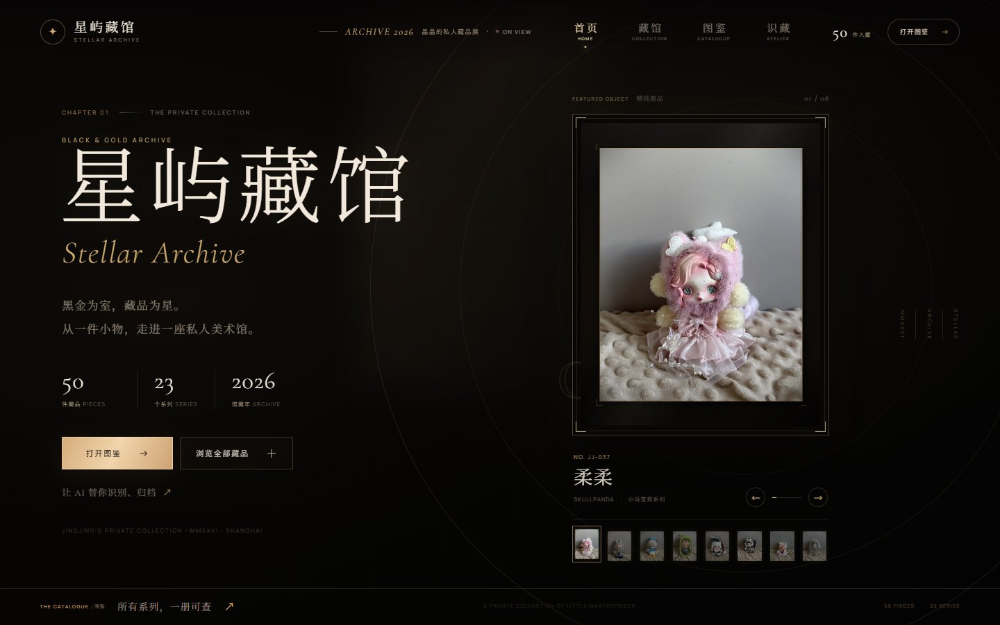
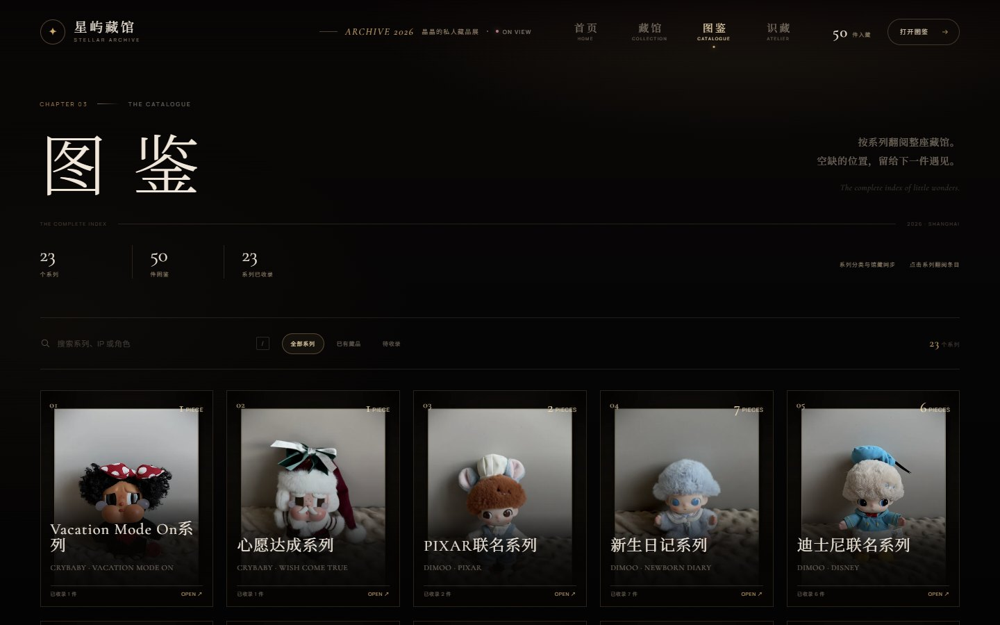
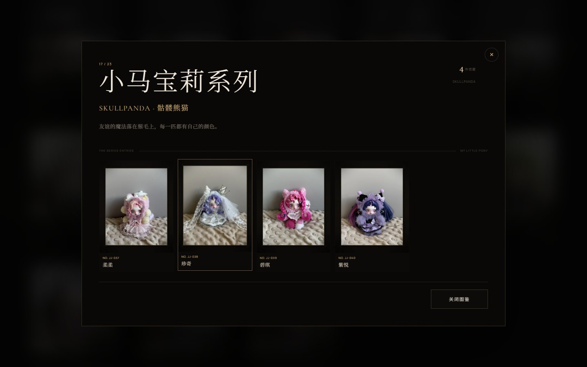
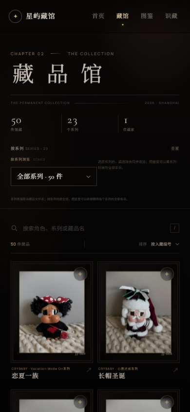
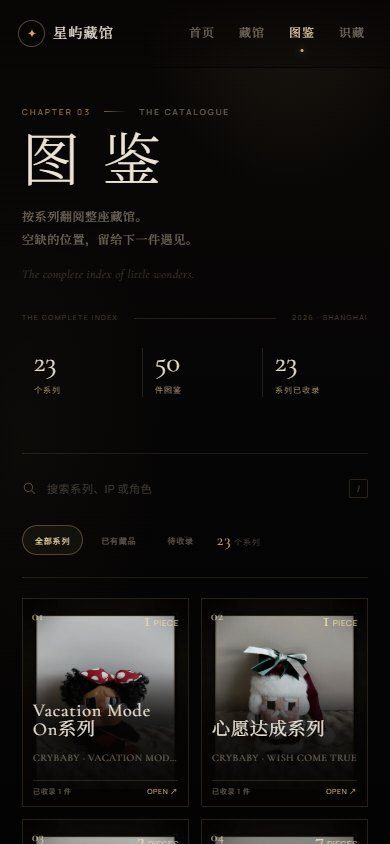

# 星屿藏馆 · STELLAR ARCHIVE

晶晶的私人泡泡玛特电子藏品馆。
黑金为室，藏品为星：**50 件真实藏品、23 个系列**，每件按「IP · 系列 · 角色」归档，拥有独立编号 `JJ-001`–`JJ-050`、金线装裱的展柜、AI 撰写的短篇介绍，以及只出现在介绍里的 **晶晶私人珍藏水印**。整个站点由 DOM、CSS 与本地图片构成，没有圣诞树，也没有 3D 粒子场景。

分类以**系列**为单位，而不是只分 IP；本地引擎与接入的 AI 仍可以根据识别结果建立新系列，新系列会写入本机，并出现在筛选、图鉴和后续识别中。

**在线浏览（GitHub Pages）：** <https://ac1314-520.github.io/stellar-archive/>



> 非官方粉丝作品。照片来自晶晶的私人藏品，不是 Pop Mart 官方图片；请勿将这些照片用于商业用途或二次转载。
> AI 识藏是可选能力：不接入时照片只留在本机；接入后照片会直接发送给你选择的模型服务商用于识别。

---

## 这次重做了什么

- **全部换成真实藏品**：删掉原来 200 张程序生成的示例图、示例数据和示例生成脚本，只保留 `泡泡玛特藏品` 文件夹里的真实照片。当前 **50 件 / 23 个系列**；未命名的 `de932…jpg` 会被构建脚本跳过。
- **按系列重新分类**：从文件名解析「IP · 系列 · 角色」；例如 `DIMOO迪士尼联名系列-唐老鸭的歌唱` 会归入 DIMOO 的「迪士尼联名系列」，不再只按 IP 归类。藏品馆的系列筛选改成完整下拉菜单，避免长系列名被截断。
- **每张照片都有展陈装裱**：构建脚本为原图加上近黑暖调背景、细腻颗粒、金色内外衬线、四角刻线和柔和阴影，输出 4:5 的 `full / card / thumb` WebP。照片本身保留原构图，外框由装裱与前端金框共同完成。
- **独立编号**：全馆 50 件从 `JJ-001` 到 `JJ-050` 独立编号；编号同时出现在首页展柜、藏馆卡片、图鉴条目、查看器和介绍水印里。
- **AI 短篇介绍**：逐张看过 50 张照片后，为每件藏品写了 1–2 句只属于它的介绍；不是套模板。系列也有各自的系列引言，会出现在图鉴的系列详情里。
- **晶晶私人水印**：查看器介绍区加入「晶晶 · 私人珍藏 / JINGJING'S PRIVATE COLLECTION / 编号」的水印与印章，只在打开藏品后的介绍中出现，不压在照片上。
- **首页精选展品**：从不同系列挑出 8 件，做成自动轮换展柜；可以左右切换、点缩略图换件，也可以直接点开 360° 查看器。
- **图鉴**：23 个系列全部入册，按系列封面排列；点开系列翻阅该系列全部条目，条目继续进入查看器。支持搜索与「全部 / 已有藏品 / 待收录」筛选。
- **纯 DOM/CSS 展厅**：不需要 WebGL，也不加载 Three.js；首屏更轻，低端手机和普通浏览器都能打开。
- **接入 AI 识藏**：在识藏室可选择 DeepSeek（视觉 + 联网检索）、豆包 Seed Vision、硅基流动、OpenRouter 或任意 OpenAI 兼容视觉接口，用你自己的 API Key 直接看图识别。
- **真实视觉调用验证**：保存 AI 配置时会用小测试图真实调用一次接口，验证的不只是 Key，还包括图片输入能力；失败会留在设置面板并显示错误。每次识图的结果卡会显示「本地初判 → AI 复核」轨迹。
- **AI 复核优先**：先由本地引擎校准，再由 AI 看图（DeepSeek 可联网检索）复核；两者不一致时以 AI 结果为准。若 AI 确认不是泡泡玛特系列，会优先用上传图片名建立新系列。

| 首页 | 图鉴 |
| --- | --- |
|  |  |

| 图鉴系列详情 | 藏品馆 |
| --- | --- |
|  |  |

| 查看器 · 晶晶水印 | 识藏室 |
| --- | --- |
|  |  |

| 手机端 · 藏品馆 | 手机端 · 图鉴 |
| --- | --- |
|  |  |

---

## 本地打开

**直接访问（若本机预览服务正在运行）**

<http://127.0.0.1:4173>

**以后自己打开**

双击项目里的 `start.bat`。它会启动一个本地静态服务并打开浏览器。

也可以手动运行：

```bash
node server.mjs
# 然后访问 http://127.0.0.1:4173
```

页面使用 IndexedDB 保存你导入的照片，**需要通过 HTTP 打开**，不要直接双击 `index.html`。只需 Node.js 18+，没有安装依赖、没有构建步骤。

- 首页：黑金展厅、精选展品自动轮换、50 件藏品与 23 个系列入口
- 藏馆：50 件真实藏品、23 个系列，搜索 / 系列下拉 / 版本 / 珍藏
- 图鉴：按系列翻阅整座藏馆；搜索、状态筛选、系列条目弹层
- 识藏：导入照片，本地轻量识别或接入 AI；未知品牌/系列会自动建立新系列，确认后入藏
- 点开任意照片：居中欣赏，拖拽 360°、上下倾斜、滚轮缩放、自动旋赏；介绍区带晶晶水印与独立编号

---

## 真实藏品与装裱

当前 50 张原图来自 `E:\deepseek工作区\泡泡玛特藏品`，构建后写入：

- `assets/photos/full/`：1200×1500，查看器与首页精选使用
- `assets/photos/card/`：600×750，首页缩略图、图鉴和藏品馆首屏使用
- `assets/photos/thumb/`：300×375，列表缩略图备用

每张原图都会经过：

1. 按 4:5 展陈比例居中裁切；
2. 放进近黑暖调装裱背景，加细颗粒、金色双衬线、四角刻线和阴影；
3. 生成 50 个独立编号 `JJ-001`–`JJ-050`；
4. 根据文件名建立系列、角色和独立数据条目；
5. 写入 AI 短篇介绍、系列引言与晶晶水印信息。

重新构建：

```bash
python scripts/build_real_archive.py
```

> 需要 Python 3.10+、Pillow、NumPy。默认读取 `E:\deepseek工作区\泡泡玛特藏品`；也可以用环境变量 `COLLECTION_SRC` 指向新文件夹。
> 新增照片时，请继续使用「IP系列-角色名」或「IP 系列.角色名」的命名方式；构建脚本会按系列重新编号并刷新图鉴。

### 命名示例

- `DIMOO迪士尼联名系列-唐老鸭的歌唱.jpg` → IP `DIMOO`，系列 `迪士尼联名系列`，角色 `唐老鸭的歌唱`
- `SKULLPANDA小马宝莉系列-紫悦.jpg` → IP `SKULLPANDA`，系列 `小马宝莉系列`，角色 `紫悦`
- `THE MONSTERS 复古理发店系列.丝绒午后.jpg` → IP `THE MONSTERS`，系列 `复古理发店系列`，角色 `丝绒午后`

一个没有命名的 `de932db58f92c4e718ffd25d8425205b.jpg` 会被跳过，不会进入馆藏。

---

## 继续添加藏品

有两种入口：

### 1. 批量构建进正式馆藏

把命名好的照片放进 `泡泡玛特藏品`，然后重新运行：

```bash
python scripts/build_real_archive.py
```

构建脚本会重新生成图片与数据，并保留「按系列编号」的规则。适合一次加入一批同系列藏品。

### 2. 从识藏室单张导入

1. 打开「识藏」页面，拖入或选择照片。
2. 本地识别会先看文件名里的 IP/品牌线索；没有线索时按主色建立一个可复用的色彩分类。也可以在识藏室右上角接入 AI。
3. AI 会优先匹配已知系列；如果识别到未知 IP、其他品牌或非泡泡玛特藏品，会提出一个新系列，并自动建立。
4. 可在结果卡片里下拉手动改成任意已有系列，或直接采用新建系列。
5. 点「确认入藏」。照片会压缩后保存到浏览器 IndexedDB，并加入藏品馆与图鉴；新系列会出现在系列下拉和图鉴里。
6. 导入数量不设上限；所有照片仍可在藏品馆与图鉴中查看。

导入的照片默认完全在浏览器本地处理，不会上传服务器。清理可点「识藏记录」下方的「清空我导入的照片」。

---

## 接入 AI 识藏（BYOK）

在「识藏」页点右上角 **本地识别 / 接入 AI**，选择引擎并填入 API Key、Base URL 与模型 ID，保存即可。Key 只保存在当前浏览器的 `localStorage`（勾选“记住”）或 `sessionStorage`（不勾选），不会出现在网页源码里。

### 豆包 Seed Vision（默认预设）

- 引擎：`豆包 Seed Vision · 火山方舟`
- Base URL：`https://ark.cn-beijing.volces.com/api/v3`
- 默认模型：`doubao-seed-2-0-lite-260215`（可在字段中改成你的模型或推理接入点 ID）
- 获取 Key：<https://console.volcengine.com/ark>

在火山方舟控制台开通视觉模型后，把 Key 与模型/接入点 ID 填进来。免费额度、模型可用性和计费以方舟控制台为准；项目本身不内置任何 Key。

### DeepSeek（视觉 + 联网）

- 引擎：`DeepSeek · 视觉 + 联网`
- Base URL：`https://api.deepseek.com`
- 默认模型：`deepseek-flash`
- 获取 Key：<https://platform.deepseek.com/api_keys>

DeepSeek 官方 Chat Completions 支持图像输入与内置 `deepseek_web_search` 工具。启用后，请求会携带图片与搜索工具，模型可联网核对 IP/角色；如果服务端不支持工具参数，项目会自动重试一次纯视觉请求，并在结果卡中标注「AI 复核」而不是「联网」。DeepSeek 的浏览器端 CORS 已探测可用。

### 其他兼容引擎

- 硅基流动：`https://api.siliconflow.cn/v1`，默认模型 `Qwen/Qwen2.5-VL-32B-Instruct`
- OpenRouter：`https://openrouter.ai/api/v1`，默认模型 `qwen/qwen2.5-vl-32b-instruct:free`
- 任意 OpenAI 兼容视觉接口：填入自己的 Base URL 和模型 ID

请求由浏览器直接发往你选择的服务商。项目不会把 Key 写到 GitHub，也没有自己的后端；因此在公开网页里内置一把公共 Key 是不安全的，这里采用每人填自己 Key 的方式。

### 先本地、再 AI

识藏时会按这个顺序执行：

1. 本地引擎先按文件名/IP/品牌线索校准；没有线索时按主色建立可复用分类。
2. 如果配置了 AI，再带图片调用 AI；DeepSeek 可启用联网搜索。
3. 本地与 AI 不一致时使用 AI 的系列结果。
4. AI 确认不是泡泡玛特系列时，优先用上传文件名的可读部分建立新分类；文件名不可读时使用 AI 提议的分类。

结果卡会显示类似「本地：MOLLY → DeepSeek 联网复核：LABUBU」的轨迹。保存 AI 配置或点击「测试连接」都会真实调用接口；只有收到响应才显示验证成功，失败会显示具体错误。

### AI 可以新建分类

提示词会要求模型：先尝试当前 23 个内置系列；如果认出的是未知 IP/其他品牌，或照片根本不是泡泡玛特，不要硬套已知系列，而是返回一个可复用的新系列名与中文名。项目会把这个系列写入本机 `localStorage`，并在筛选、图鉴和后续识别中复用它。

- 新分类由 AI（或本地主色/品牌线索）自动建立，标记为 `NEW`。
- 新分类不会覆盖内置分类；如果你手动改回已有系列，分类本身仍会保留，方便同类照片继续使用。
- 分类与照片仍然只保存在浏览器里；不同浏览器/设备不共享。
- 如果 AI 接口失败，识藏室会使用本地分类，并提示失败原因。

### 隐私说明

- 仅使用本地识别时，照片不会离开你的浏览器。
- 启用 AI 后，**你选择提交的照片会直接发送给对应的模型服务商**用于识别。
- 识别失败、超时或 CORS 被拒绝时，识藏室会回退到本地识别，并提示原因。
- 在公共电脑上不建议勾选“记住这段配置”。


---

## 目录结构

```text
starlit-archive/
├── index.html                      页面结构
├── server.mjs                      零依赖本地静态服务
├── start.bat                       Windows 一键启动
├── css/styles.css                  黑金展厅、图鉴与移动端样式
├── js/
│   ├── series.js                   23 个真实系列、关键词与常用工具
│   ├── collection-data.js          50 件真实藏品数据（自动生成）
│   └── app.js                      路由、首页、图鉴、藏品馆、360° 查看器、识藏、动态分类、IndexedDB、AI
├── assets/
│   ├── fonts/                      Cormorant Garamond + Manrope
│   ├── photos/full/                50 张 1200×1500 装裱全图
│   ├── photos/card/                50 张 600×750 展厅卡片图
│   ├── photos/thumb/               50 张 300×375 缩略图
│   └── preview/                    预览与分享封面
└── scripts/
    └── build_real_archive.py       读取原图、装裱、分类、编号、生成数据
```

---

## 设计与实现要点

- **黑金视觉**：深黑背景、香槟金细线、Cormorant Garamond 衬线标题与 Manrope 小字；展厅边界用大留白和低亮度射灯构成，避免任何圣诞树、雪景或粒子元素。
- **首页**：8 件跨系列精选展品；每 6.8 秒自动换件，支持左右切换、缩略图跳转和直接打开查看器。首屏预载 6 张图，低端设备也能较快进入。
- **图鉴**：按 `SERIES_ORDER` 生成 23 张系列卡；系列卡以「系列」为主标题，IP 作副标题；点开系列弹层可浏览全部条目，条目继续进入查看器。图鉴搜索、状态筛选和藏品数据共享同一份 `state.items`。
- **清晰度**：首页、图鉴和藏馆使用 600×750 卡片图；查看器才读取 1200×1500 装裱全图。
- **分类系统**：当前 23 个系列；新系列保存在 `localStorage`，会重新生成筛选、图鉴、结果下拉和 AI 提示词。系列下拉按 IP 分组。
- **独立编号**：构建脚本按系列顺序生成 `JJ-001`–`JJ-050`；编号在首页、藏馆、图鉴、查看器和介绍水印中保持一致。
- **装裱与包装**：每张原图先放进 4:5 的黑金展陈卡，再叠加前端的金色画框、角线和编号标签。图鉴与查看器沿用同一套装裱语言，像一套可翻阅的藏品包装。
- **所有者水印**：查看器介绍区有「晶晶 · 私人珍藏」印章、英文水印与编号，不覆盖照片。
- **360° 查看**：照片被放在双面卡片中，拖拽可连续旋转；支持自动旋赏、缩放、左右切换、收藏；移动端可上下滚动阅读完整档案。
- **隐私**：没有后端数据库；导入照片、收藏、AI 配置和新建分类都存在浏览器本机。
- **交互与装裱参考**：黑金展厅、图鉴索引、作品框与藏品卡的思路参考了 GitHub 上的 [artwork-3D-museum](https://github.com/TomPast/artwork-3D-museum)、[minimal-gallery-eo](https://github.com/yohteq/minimal-gallery-eo)、[GitHub museum topic](https://github.com/topics/museum) 以及 [Gold-Black Museum Web Design](https://dribbble.com/shots/22765418-Gold-Black-Museum-Web-Design)；本项目使用自己的 DOM/CSS、装裱脚本和照片数据重新实现，不加载 Three.js。

---

## 兼容性

- 推荐最新版 Chrome / Edge / Safari；不需要 WebGL。
- 首屏是纯 DOM、CSS 与卡片图；没有 Canvas、Three.js 或 WebGL 依赖。
- 通过本地 HTTP 服务或 GitHub Pages 打开；`file://` 下 IndexedDB 与部分字体/接口会受限。
- AI 接口使用浏览器直连，是否可用取决于服务商 CORS 策略。若线上豆包可用而本地调试被 CORS 拒绝，属于浏览器端接口限制，不是项目代码报错。

---

## 常见问题

**页面停在“正在布置展厅”**
首屏在预载精选展品的图片；正常网络下很快完成。若超过十几秒，刷新页面或检查本地服务是否运行。

**双击 index.html 打开是空白 / 照片不显示**
请用 `start.bat` 或 `node server.mjs` 通过 HTTP 访问。

**手机打开还是旧版 / 看不到新首页**
刷新一次页面；样式和脚本已带版本参数，通常刷新即可。如果仍停在旧版，清除该站点的缓存或用无痕窗口打开。

**图鉴怎么用？**
打开「图鉴」，23 个系列按封面排列。点任意系列卡会打开该系列的全部条目；再点条目就进入 360° 查看器。顶部可以搜索系列/IP，也可以筛「已有藏品」或「待收录」。

**为什么系列卡里有的系列是空的？**
当前真实照片覆盖 23 个系列；如果通过 AI 新建了系列但还没有藏品，图鉴会以金色缩写占位，显示「待收录」。导入照片后会自动填充。

**每件藏品的编号在哪里看？**
在首页展柜、藏馆卡片、图鉴条目、查看器顶部和介绍水印里都会出现 `JJ-xxx`。编号由构建脚本独立生成，和文件名无关。

**为什么打开藏品后有一块「晶晶 · 私人珍藏」？**
这是应所有者要求加的介绍区水印，不会覆盖照片本身；英文水印、印章和该件的独立编号会一起显示。

**首页的展品会自动换吗？**
会，每 6.8 秒换一件；鼠标移到展柜上不会停，点左右箭头或缩略图会立即切换。点展柜本身可以打开查看器。

**导入照片后在哪里看？**
所有藏品都在「藏馆」；同一个系列也会自动归入「图鉴」，图鉴里可以按系列翻阅。首页只展示跨系列精选的 8 件，不是全部。

**豆包 API 一直 404 怎么办？**
优先检查三处：
1. Base URL 必须是 `https://ark.cn-beijing.volces.com/api/v3`（粘贴完整 endpoint 也能识别）。
2. 模型字段填火山方舟控制台「开通管理」里已开通的完整 Model ID，或 `ep-` 开头的推理接入点 ID；不要填接口地址。
3. 到方舟控制台确认该 API Key 所属项目已开通这个视觉模型。设置面板现在会用一张小测试图真实调用；404 会直接给出排查提示。

**DeepSeek 能连接但识图失败？**
设置面板的「保存并真实调用验证」现在会测试图片输入，不再只测文本。识图失败时，DeepSeek 会先自动重试一次纯视觉请求（不带联网工具），并在结果卡中显示本地与 AI 的对照轨迹；如果两次都失败，界面会保留具体错误。

**为什么很多分类显示「待」？**
当前 50 件真实藏品覆盖 23 个系列；通过 AI 新建但还没有照片的系列会保留在图鉴里，等待下一件藏品。AI/本地识别会自动把照片放进对应系列。

**新分类会不会丢？**
会保存在当前浏览器的 `localStorage`；刷新仍在。清理浏览器网站数据会一并移除，不同设备不会同步。

**AI 识别失败怎么办？**
先确认 Key、Base URL、模型 ID 三项；看识藏页的提示。接口超时、CORS 或额度不足都会自动回退到本地分类。可以先直接选择一张真实藏品照片测试接口。

**识藏室会把我的照片上传吗？**
你选择本地识别时不会。你启用 AI 并提交照片后，所选照片会直接发给你配置的模型服务商；本站没有中转服务器。

**识别不准**
本地识别只按文件名或主色做轻量建议；没有 IP 线索时会建立色彩分类，而不是硬猜。AI 识别受模型与照片清晰度影响。识别结果都可以在入藏前手动修改系列；新分类也可以继续复用。
