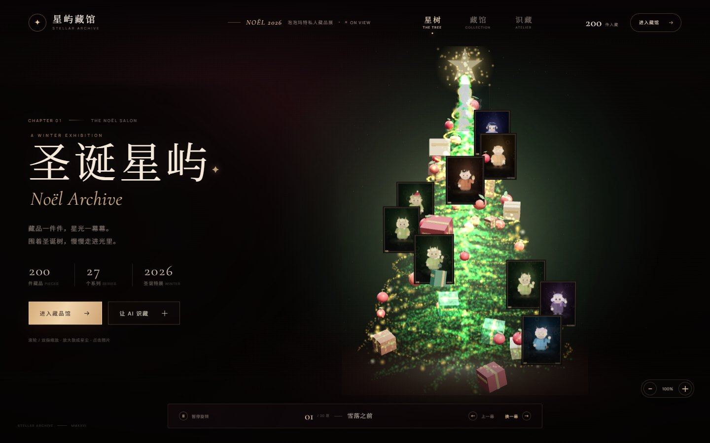
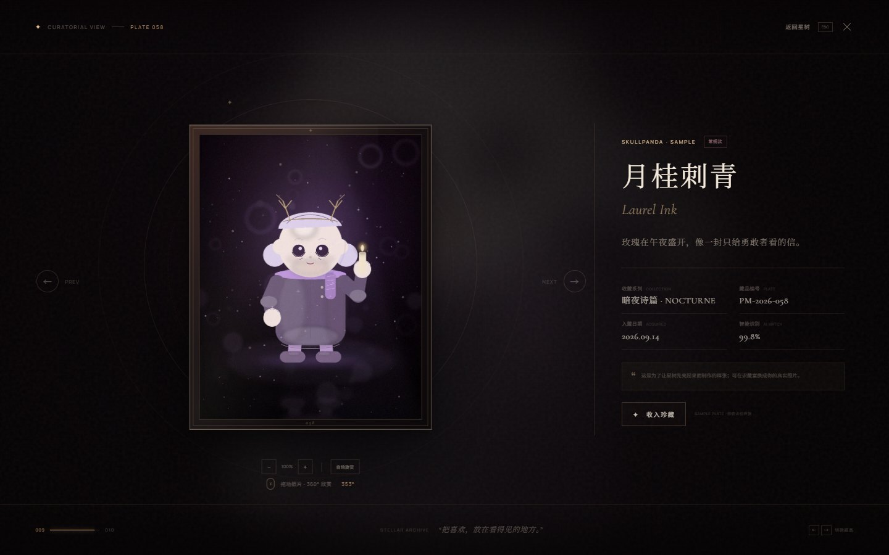
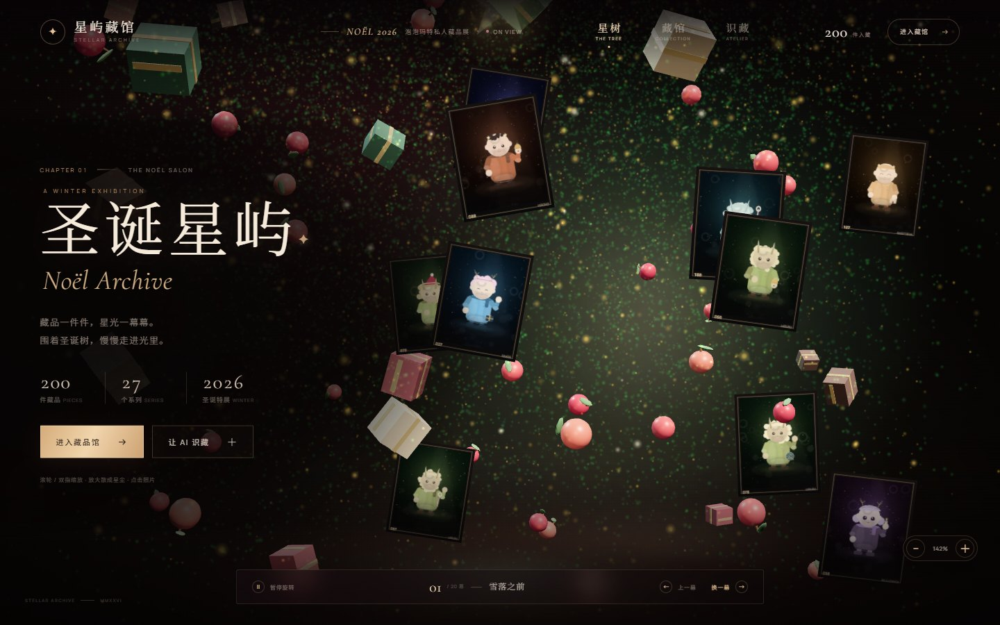
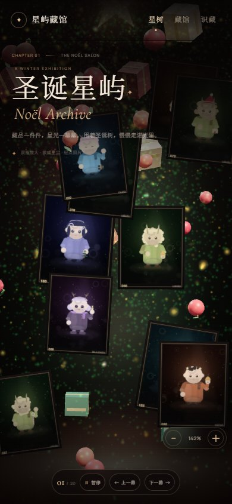
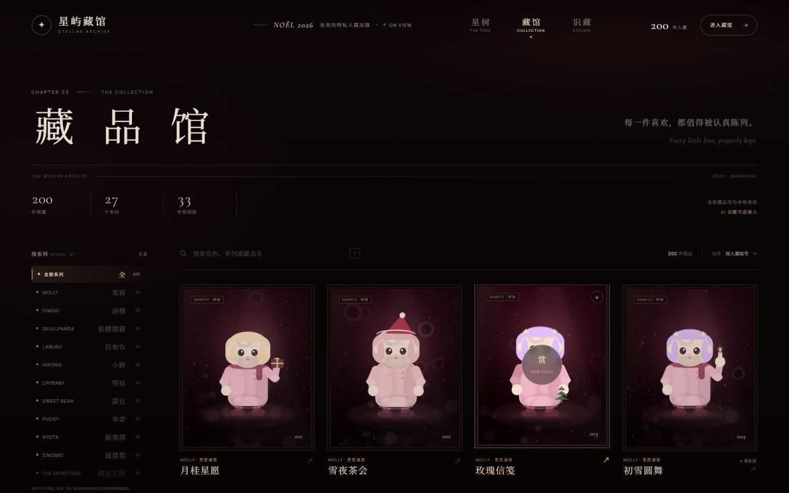
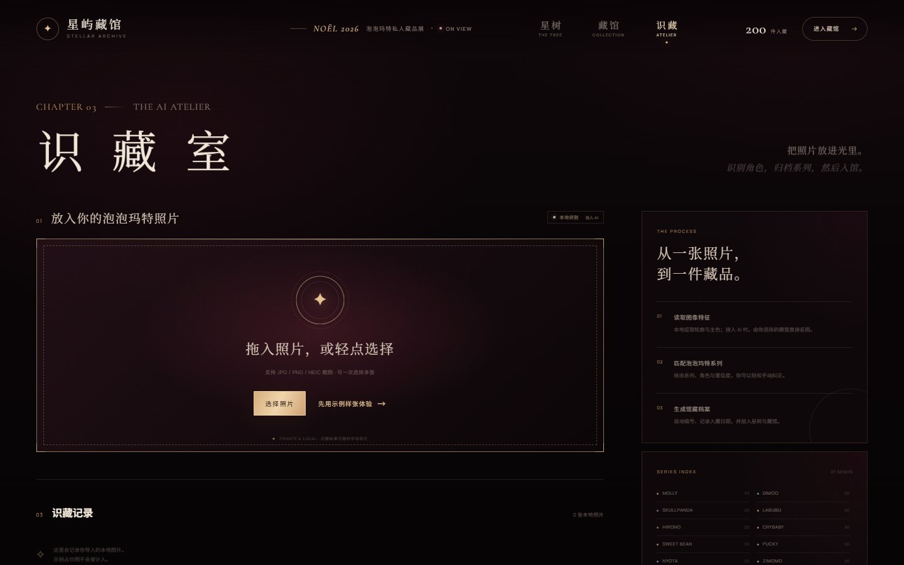
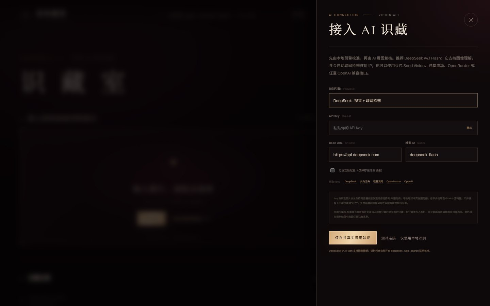

# 星屿藏馆 · STELLAR ARCHIVE

一个可以直接在浏览器里打开的私人泡泡玛特电子藏品馆。
200 件示例藏品分成二十幕，每幕十件。发光的粒子圣诞树由苹果、礼物盒和十幅照片共同组成，在暗色展厅中缓慢自转；放大会散成满天星尘，照片可以随手点开欣赏。另设独立藏品馆与支持 AI 的识藏室。

分类从原来的 10 个扩到 **27 个**，并允许本地引擎与接入的 AI 根据识别结果**自动建立新的分类**；新分类会保存在本机，出现在筛选、结果和后续识别中。

**在线浏览（GitHub Pages）：** <https://ac1314-520.github.io/stellar-archive/>



> 非官方粉丝作品。示例照片是程序生成的原创潮玩概念样张，不是 Pop Mart 官方图片。
> AI 识藏是可选能力：不接入时照片只留在本机；接入后照片会直接发送给你选择的模型服务商用于识别。

---

## 这次重做了什么

- **换成粒子圣诞树**：旧实体树、松枝网格、树干和玻璃球全部移除。树体由约 3 万颗发光粒子组成：深绿色枝叶、金色灯线、暖灯和树顶星；从远处看是树，凑近看全是漂浮的光点。
- **分类扩充**：内置 27 个本地分类，覆盖泡泡玛特官方主要 IP（连同 THE MONSTERS、HACIPUPU、TWINKLE TWINKLE、KUBO、ZSIGA、POLAR、PINO JELLY、DUCKOO、1001MOONS、SUPERTUTU、PEACH RIOT、CHAKA、TINY TINY、MERODI、KEYA、RIBODIARY 等），另加自由收藏。
- **分类可以被识别引擎扩展**：本地引擎与接入的 AI 都获得建立新分类的权限。遇到未知泡泡玛特 IP、其他品牌或无法硬套的藏品时，会按识别结果建立新分类；新分类写入浏览器，并标记为 `NEW`。
- **苹果、礼物与照片共同组成树**：34 颗红苹果、15 个系金丝带的礼物盒和当前一幕的 10 张照片分布在树体里；树体、苹果和礼物缓慢自转，照片留在正面 S 形带上，方便随手点击。
- **放大散成星尘**：缩放超过约 112% 后，画布扩展为全屏，树开始向外扩散；到 142% 时粒子、苹果、礼物和照片铺满整页，照片仍然可以点击。缩小回去会重新聚合成树。
- **照片保持清楚**：首屏加载 500×625 的卡片图，点击后再读取高清全图；照片尺寸固定，只在手动缩放时跟着树一起变化。
- **手机控制条**：底部提供暂停旋转、上一幕、下一幕；缩放按钮位于右上方，控制条不占用标题下方。
- **开场**：只预载当前一幕的 10 张照片并初始化粒子树；使用本地 Three.js，不依赖外网 CDN。
- **接入 AI 识藏**：在识藏室可选择 DeepSeek（视觉 + 联网检索）、豆包 Seed Vision、硅基流动、OpenRouter 或任意 OpenAI 兼容视觉接口，用你自己的 API Key 直接看图识别。
- **真实视觉调用验证**：保存 AI 配置时会用小测试图真实调用一次接口，验证的不只是 Key，还包括图片输入能力；失败会留在设置面板并显示错误，不再只把“已接入”写在界面上。每次识图的结果卡也会显示「本地初判 → AI 复核」轨迹。
- **AI 复核优先**：先由本地引擎校准，再由 AI 看图（DeepSeek 可联网检索）复核；两者不一致时以 AI 结果为准。若 AI 确认不是泡泡玛特系列，会优先用上传图片名建立新分类。

| 手机端 | 360° 查看 |
| --- | --- |
|  |  |

| 放大散成星尘 | 手机散开 |
| --- | --- |
|  |  |

| 藏品馆 | 识藏室 |
| --- | --- |
|  |  |

---

## 本地打开

**直接访问（若本机预览服务正在运行）**

<http://127.0.0.1:4173>

**以后自己打开**

双击项目里的 `start.bat`。它会启动一个本地静态服务并打开浏览器。

也可以手动运行：

```bash
node server.mjs
# 然后访问 http://127.0.0.1:4173
```

页面使用 IndexedDB 保存你导入的照片，**需要通过 HTTP 打开**，不要直接双击 `index.html`。只需 Node.js 18+，没有安装依赖、没有构建步骤。

- 首页：粒子圣诞树、苹果礼物与 S 形照片带
- 藏馆：200 件示例藏品、27 个分类，搜索 / 系列筛选 / 版本筛选 / 珍藏
- 识藏：导入照片，本地轻量识别或接入 AI；未知品牌/系列会自动建立新分类，确认后入藏
- 点开任意照片：居中欣赏，拖拽 360°、上下倾斜、滚轮缩放、自动旋赏

---

## 示例照片

`assets/photos/` 下有 200 张 4:5 的原创潮玩概念样张：

- `full/`：720×900，点击查看时读取
- `card/`：500×625，星树轨道与藏品馆首屏使用
- `thumb/`：300×375，旧版缩略图与导入流程备用

由 `scripts/generate_placeholders.py` 使用 Pillow + NumPy 离线绘制；
`scripts/generate_cards.py` 从全图生成 500 px 卡片图；
`js/tree-scene.js` 用 Three.js 实时渲染粒子树、苹果、礼物、S 形照片带、旋转与散开；
`js/vendor/three.min.js` 是本地 Three.js r149（MIT License），不依赖外网 CDN。

样张分布：

- 现有 200 张样张主要覆盖 10 个核心 IP：MOLLY、DIMOO、SKULLPANDA、LABUBU、HIRONO、CRYBABY、SWEET BEAN、PUCKY、NYOTA、ZIMOMO，每个 20 件。
- 其余 17 个分类（含 THE MONSTERS、HACIPUPU、TWINKLE TWINKLE、KUBO、ZSIGA、POLAR、PINO JELLY、DUCKOO、1001MOONS、SUPERTUTU、PEACH RIOT、CHAKA、TINY TINY、MERODI、KEYA、RIBODIARY、自由收藏）已开放，但样张暂时为空，筛选中标记为「待」。
- 你导入照片，或让 AI 识别后，它们会自动进入对应分类；AI 也可以继续创建这 27 个之外的新分类。

想重新生成：

```bash
python scripts/generate_placeholders.py
python scripts/generate_cards.py
```

> 需要 Python 3.10+、Pillow、NumPy。第一条命令会重写 `js/collection-data.js`。

---

## 换成你的真实照片

1. 打开「识藏」页面。
2. 拖入或选择照片（一次最多 30 张，JPG / PNG / WebP 等常用格式）。
3. 本地识别会先看文件名里的 IP/品牌线索；没有线索时按主色建立一个可复用的色彩分类（例如「柔粉收藏」）。也可以在识藏室右上角接入 AI。
4. AI 会优先匹配已知分类；如果识别到未知 IP、其他品牌或非泡泡玛特藏品，会提出一个新分类，并自动建立。
5. 可在结果卡片里下拉手动改成任意已有系列，或直接采用新建分类。
6. 点「确认入藏」。照片会压缩后保存到浏览器 IndexedDB，并加入藏品馆与星树；新分类会出现在系列筛选里。
7. 超过 200 件后，轨道会在二十幕之外增加新的展幕；所有照片仍可在藏品馆查看。

导入的照片默认完全在浏览器本地处理，不会上传服务器。清理可点「识藏记录」下方的「清空我导入的照片」。

---

## 接入 AI 识藏（BYOK）

在「识藏」页点右上角 **本地识别 / 接入 AI**，选择引擎并填入 API Key、Base URL 与模型 ID，保存即可。Key 只保存在当前浏览器的 `localStorage`（勾选“记住”）或 `sessionStorage`（不勾选），不会出现在网页源码里。

### 豆包 Seed Vision（默认预设）

- 引擎：`豆包 Seed Vision · 火山方舟`
- Base URL：`https://ark.cn-beijing.volces.com/api/v3`
- 默认模型：`doubao-seed-2-0-lite-260215`（可在字段中改成你的模型或推理接入点 ID）
- 获取 Key：<https://console.volcengine.com/ark>

在火山方舟控制台开通视觉模型后，把 Key 与模型/接入点 ID 填进来。免费额度、模型可用性和计费以方舟控制台为准；项目本身不内置任何 Key。

### DeepSeek（视觉 + 联网）

- 引擎：`DeepSeek · 视觉 + 联网`
- Base URL：`https://api.deepseek.com`
- 默认模型：`deepseek-flash`
- 获取 Key：<https://platform.deepseek.com/api_keys>

DeepSeek 官方 Chat Completions 支持图像输入与内置 `deepseek_web_search` 工具。启用后，请求会携带图片与搜索工具，模型可联网核对 IP/角色；如果服务端不支持工具参数，项目会自动重试一次纯视觉请求，并在结果卡中标注「AI 复核」而不是「联网」。DeepSeek 的浏览器端 CORS 已探测可用。

### 其他兼容引擎

- 硅基流动：`https://api.siliconflow.cn/v1`，默认模型 `Qwen/Qwen2.5-VL-32B-Instruct`
- OpenRouter：`https://openrouter.ai/api/v1`，默认模型 `qwen/qwen2.5-vl-32b-instruct:free`
- 任意 OpenAI 兼容视觉接口：填入自己的 Base URL 和模型 ID

请求由浏览器直接发往你选择的服务商。项目不会把 Key 写到 GitHub，也没有自己的后端；因此在公开网页里内置一把公共 Key 是不安全的，这里采用每人填自己 Key 的方式。

### 先本地、再 AI

识藏时会按这个顺序执行：

1. 本地引擎先按文件名/IP/品牌线索校准；没有线索时按主色建立可复用分类。
2. 如果配置了 AI，再带图片调用 AI；DeepSeek 可启用联网搜索。
3. 本地与 AI 不一致时使用 AI 的系列结果。
4. AI 确认不是泡泡玛特系列时，优先用上传文件名的可读部分建立新分类；文件名不可读时使用 AI 提议的分类。

结果卡会显示类似「本地：MOLLY → DeepSeek 联网复核：LABUBU」的轨迹。保存 AI 配置或点击「测试连接」都会真实调用接口；只有收到响应才显示验证成功，失败会显示具体错误。

### AI 可以新建分类

提示词会要求模型：先尝试 27 个内置分类；如果认出的是未知 IP/其他品牌，或照片根本不是泡泡玛特，不要硬套已知系列，而是返回一个可复用的新分类名与中文名。项目会把这个分类写入本机 `localStorage`，并在筛选和后续识别中复用它。

- 新分类由 AI（或本地主色/品牌线索）自动建立，标记为 `NEW`。
- 新分类不会覆盖内置分类；如果你手动改回已有系列，分类本身仍会保留，方便同类照片继续使用。
- 分类与照片仍然只保存在浏览器里；不同浏览器/设备不共享。
- 如果 AI 接口失败，识藏室会使用本地分类，并提示失败原因。

### 隐私说明

- 仅使用本地识别时，照片不会离开你的浏览器。
- 启用 AI 后，**你选择提交的照片会直接发送给对应的模型服务商**用于识别。
- 识别失败、超时或 CORS 被拒绝时，识藏室会回退到本地识别，并提示原因。
- 在公共电脑上不建议勾选“记住这段配置”。



---

## 目录结构

```text
starlit-archive/
├── index.html                      页面结构
├── server.mjs                      零依赖本地静态服务
├── start.bat                       Windows 一键启动
├── css/styles.css                  视觉、轨道布局与移动端样式
├── js/
│   ├── series.js                   27 个内置分类、关键词与常用工具
│   ├── collection-data.js          200 件示例藏品数据（自动生成）
│   ├── tree-scene.js               Three.js 粒子树、苹果礼物、照片、旋转与散开
│   ├── vendor/three.min.js         本地 Three.js r149
│   └── app.js                      路由、二十幕粒子树、藏品馆、360° 查看器、识藏、动态分类、IndexedDB、AI
├── assets/
│   ├── fonts/                      Cormorant Garamond + Manrope
│   ├── photos/full/                200 张 720×900 示例全图
│   ├── photos/card/                200 张 500×625 轨道卡片图
│   ├── photos/thumb/               200 张 300×375 缩略图
│   ├── tree-fallback.webp          不支持 WebGL 时的静态树兜底
│   └── preview/                    预览与分享封面
└── scripts/
    ├── generate_placeholders.py    生成原创示例藏品图
    └── generate_cards.py           生成轨道卡片图
```

---

## 设计与实现要点

- **粒子树**：`ACT_SIZE = 10`，每幕十张照片。粒子由分支簇和内部体积点组成，约 3 万颗（手机约 1.7 万）；每个粒子带独立颜色、大小和散开目标，缩放时由着色器一起推散。
- **树体自转**：`treeRoot` 以约 0.105 弧度/秒自转，苹果、礼物盒、金色灯线跟着转；照片停在正面 S 带，避免照片绕到背面不可点。
- **放大散开**：缩放范围 0.78–1.42。超过 1.12 时画布扩展为全屏，粒子、苹果、礼物和照片向四周扩散；照片散开后仍保留 3D 点击热区。
- **静态兜底**：设备不支持 WebGL 时显示静态树图 `assets/tree-fallback.webp`，避免出现空白画布。
- **清晰度**：卡片使用 500 px 源图；查看器才加载 720×900 全图。
- **手机布局**：顶部导航保持 44 px 触控高度；暂停/上一幕/下一幕控制条悬浮在底部，缩放按钮位于其右上方，不遮挡藏品馆内容。
- **分类系统**：内置 27 个分类；新分类保存在 `localStorage`，会重新生成筛选、结果下拉和 AI 提示词。带「待」的分类表示尚未收进照片。
- **360° 查看**：照片被放在双面卡片中，拖拽可连续旋转；支持自动旋赏、缩放、左右切换、收藏；移动端可上下滚动阅读完整档案。
- **隐私**：没有后端数据库；导入照片、收藏、AI 配置和新建分类都存在浏览器本机。
- **交互参考**：粒子聚合/散开与照片画廊的思路参考了 GitHub 上的 [3D 粒子圣诞树](https://github.com/electronicminer/gesture-Christmas_tree-3d_with_photo) 和 [手势粒子树](https://github.com/fuguther/gesture-christmas-tree-2)；本项目使用自己的场景、分类和照片数据重新实现。

---

## 兼容性

- 推荐最新版 Chrome / Edge / Safari。
- **需要 WebGL** 才能看到完整粒子树、苹果礼物与照片散开；不支持时会显示静态树兜底图，藏品馆与识藏室仍可正常使用。
- 首屏是 DOM、CSS、卡片图与一个 Three.js Canvas。
- 通过本地 HTTP 服务或 GitHub Pages 打开；`file://` 下 IndexedDB 与部分字体/接口会受限。
- AI 接口使用浏览器直连，是否可用取决于服务商 CORS 策略。若线上豆包可用而本地调试被 CORS 拒绝，属于浏览器端接口限制，不是项目代码报错。

---

## 常见问题

**页面停在“正在点亮星树”**
首屏在预载当前一幕的 10 张卡片图并初始化 3D 树；正常网络下很快完成。若超过十几秒，刷新页面或检查本地服务是否运行。

**双击 index.html 打开是空白 / 照片不显示**
请用 `start.bat` 或 `node server.mjs` 通过 HTTP 访问。

**手机打开还是旧版 / 看不到 3D 树**
刷新一次页面；样式和脚本已带版本参数，通常刷新即可。如果仍停在旧版，清除该站点的缓存或用无痕窗口打开。若设备不支持 WebGL，会改为显示静态树图。

**导入照片后星树怎么没有全部出现？**
粒子树一次展示一幕的十张照片，沿树体正面循环流动。换到下一幕即可看到下一组；全部 200 件在「藏馆」里始终可以搜索、筛选和查看。

**放大后照片飞得到处都是，怎么点？**
散开的照片仍然是可点击的 3D 卡片；点任意一张就会打开查看器。缩小回去照片会重新聚成 S 形照片带。

**怎么放大/缩小圣诞树？**
桌面用滚轮，手机用双指捏合；也可以点右下角的 `−` / `＋`。范围约 78%–142%；超过约 112% 后树开始散开，142% 时铺满整页。照片会跟着树一起放大、缩小或散开。

**豆包 API 一直 404 怎么办？**
优先检查三处：
1. Base URL 必须是 `https://ark.cn-beijing.volces.com/api/v3`（粘贴完整 endpoint 也能识别）。
2. 模型字段填火山方舟控制台「开通管理」里已开通的完整 Model ID，或 `ep-` 开头的推理接入点 ID；不要填接口地址。
3. 到方舟控制台确认该 API Key 所属项目已开通这个视觉模型。设置面板现在会用一张小测试图真实调用；404 会直接给出排查提示。

**DeepSeek 能连接但识图失败？**
设置面板的「保存并真实调用验证」现在会测试图片输入，不再只测文本。识图失败时，DeepSeek 会先自动重试一次纯视觉请求（不带联网工具），并在结果卡中显示本地与 AI 的对照轨迹；如果两次都失败，界面会保留具体错误。

**为什么很多分类显示「待」？**
内置分类是完整的 IP 目录，但 200 张示例样张只覆盖其中 10 个核心 IP。其余分类等待你导入第一张照片；AI/本地识别会自动把照片放进对应分类。

**新分类会不会丢？**
会保存在当前浏览器的 `localStorage`；刷新仍在。清理浏览器网站数据会一并移除，不同设备不会同步。

**AI 识别失败怎么办？**
先确认 Key、Base URL、模型 ID 三项；看识藏页的提示。接口超时、CORS 或额度不足都会自动回退到本地分类。可先用「示例样张」测试接口。

**识藏室会把我的照片上传吗？**
你选择本地识别时不会。你启用 AI 并提交照片后，所选照片会直接发给你配置的模型服务商；本站没有中转服务器。

**识别不准**
本地识别只按文件名或主色做轻量建议；没有 IP 线索时会建立色彩分类，而不是硬猜。AI 识别受模型与照片清晰度影响。识别结果都可以在入藏前手动修改系列；新分类也可以继续复用。
